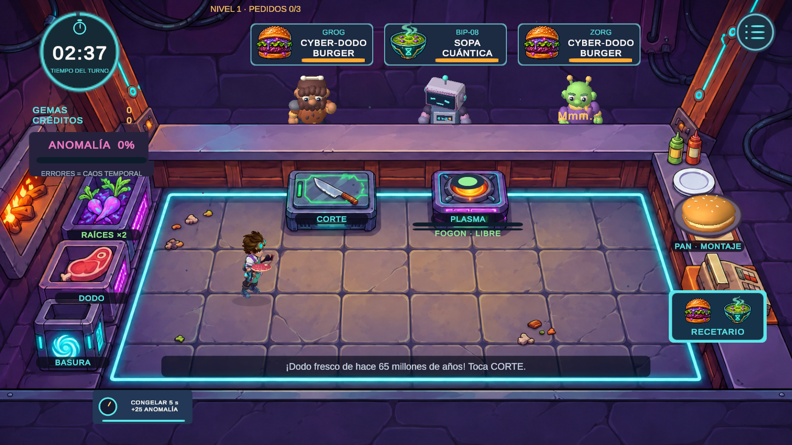
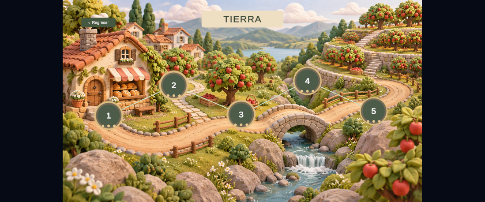

# Chronos Chef — beta 0.4.0-beta.2

Unity 6000.3.28f1 · 2D URP · horizontal · sin conexión.
Escena inicial: Assets/ChronosChef/Scenes/ChronosKitchen.unity.

[Ver la tostada mutante en el recetario 3D](Docs/media/recetario-3d.png)

[Ver a Ares caminar, recoger y cocinar en una partida](Docs/media/ares-en-movimiento.webp)

## Empezar

Pulsa Play. La portada tiene JUGAR, CONTINUAR TURNO (cuando hay guardado), ENTRENAMIENTO, AJUSTES y CRÉDITOS. JUGAR abre el portal de niveles y mejoras. La primera entrada al nivel 1 inicia el entrenamiento; después se puede repetir con ENTRENAMIENTO.

El tutorial enseña ambas recetas en doce pasos, señala la estación siguiente y detiene la presión del reloj, la paciencia y el quemado. No concede monedas, estrellas ni desbloqueos de campaña.

- Burger: DODO → dejar en CORTE → recoger de CORTE → PLASMA → esperar LISTO → retirar → añadir PAN en MONTAJE → cliente que pida burger.
- Sopa: RAÍCES dos veces → PLASMA → esperar LISTO → PLASMA para retirar el bol → cliente que pida sopa.
- Tostada mutante desde el nivel 3: una RAÍZ → dejar en CORTE → recoger los cubos → PAN → cliente que pida tostada. Puedes montarla mientras otro plato ocupa el fogón.
- CONGELAR concede cinco segundos de reloj y paciencia detenidos. La cocina sigue funcionando. Cuesta 25 de anomalía y se recarga en 32 segundos de juego.
- Toca una zona libre de la mitad derecha y arrastra para mover a Ares. La palanca aparece bajo el dedo y desaparece al soltar. Toca una estación o cliente para interactuar. En el Editor puedes caminar con WASD o las flechas y usar la estación con E.
- También puedes tocar una estación para caminar e interactuar al llegar. Mover la palanca recupera el control manual durante el trayecto.
- Toca cuerpo, cabeza o tarjeta del cliente para entregar.
- La cuchilla trabaja sola. Puedes ir a otra estación y volver con las manos libres. La mesa también corta raíces y conserva el ingrediente al guardar la partida.
- La comida transportada se muestra en las manos. BASURA descarta ese objeto.
- La registradora abre el recetario ilustrado y pausa el turno. ENTENDIDO lo reanuda directamente. Puedes elegir receta y paso o dejar que la demostración avance sola.

## Mundo 1 · Tierra

En **Jugar → Tierra**, toca un nodo para consultar el objetivo, el tiempo y el mejor resultado antes de comenzar. Cada mundo tiene un mapa de maqueta y una cocina propia. Las mejoras se encuentran en la ficha del turno.

Los destinos de cinco turnos se registran en `KitchenLevel.Worlds` con su nombre, mapa y escenario de Resources. Añade los turnos a `KitchenLevel.All` en el mismo orden. El selector distribuye los mundos en páginas de cuatro; las ilustraciones de página son `PlanetAtlas`, `PlanetAtlas2` y sucesivas, con las miniaturas ordenadas de izquierda a derecha.

## Campaña y mecánicas

Treinta y cinco turnos, tres recetas y cuatro especies en tres puestos. KitchenRecipe reúne la ilustración, ingredientes, instrucciones y mensajes que usan la comanda y el recetario de cada plato. Grog ruge y reduce la paciencia de vecinos, BIP-08 tiembla al impacientarse, Rex penaliza más la reputación al arañar la barra y Zorg levita. Los clientes llegan desde el pasillo derecho del comedor. La comanda aparece al alcanzar el mostrador y, tras el servicio o al agotarse su paciencia, regresan al fondo por la izquierda.

Cocción y margen de quemado independientes, basura, combos, propinas, reputación, estrellas y derrota por tiempo/reputación. El fogón funciona mientras Ares hace otras tareas. Las rutas evitan las estaciones con margen para sus pies. El clon aparece durante 15 segundos al alcanzar 100% de anomalía y no ocupa puntos de servicio. Un aviso translúcido aparece durante los primeros 3,2 segundos de la anomalía.

Tierra, Ferrum, Bruma, Cumbre, Jurásico, Futuro y Xeno tienen cinco turnos cada uno, un mapa y una cocina con comedor propio. Comparten distribución física para conservar rutas e interacciones. Completar un nivel abre el siguiente; tres gemas abren la segunda era. Cada nivel da una gema solo la primera vez que obtiene tres estrellas. Botas y plasma tienen tres mejoras compradas con créditos ganados en juego.

## Beta para Android

La beta 0.4.0-beta.2 se instala con el APK ARM64 en Android 7.1 o posterior. El menú **Chronos Chef → Android → Build playable beta APK** genera la versión de prueba en `Builds/Android/Beta`. La versión instalada conserva el progreso si la actualización usa la misma firma y el mismo identificador de aplicación.

## Guardado e interrupciones

Créditos, mejores estrellas, mejoras, niveles, era y entrenamiento completado se guardan localmente. La partida activa se guarda cada cinco segundos, al pausar, al salir al portal y al cerrar/suspender la aplicación. Incluye comida, cocción, clientes, reputación, anomalía y reloj. RECUPERAR/CONTINUAR la restaura en pausa. Comenzar otro turno desde el portal pide confirmar si sustituye un guardado.

Los guardados inválidos se descartan sin bloquear el inicio. No hay cuentas, servidor, anuncios ni compras reales. Los PlayerPrefs son un guardado local, no un sistema contra trampas.

## Arte, sonido y móvil

Portada e icono propios y escenarios ilustrados. Ares, su eco y los cuatro comensales se dibujan con modelos de Blender. La distancia recorrida marca el ritmo de las piernas. Los brazos sostienen el ingrediente al caminar y cambian de postura al cortar, atender el fogón o entregar. Grog golpea la barra, BIP hace gestos mecánicos, Zorg cata el aroma y Rex olfatea.

Música y efectos originales sintetizados; volúmenes separados y persistentes, música atenuada en pausa y audio suspendido al pasar al fondo. AJUSTES incluye movimiento reducido.

Preparado para ambas orientaciones horizontales, área segura, objetivo de 60 fps en móvil y texturas de la beta con compresión ASTC para Android. La vista 16:9 se adapta con bandas cuando la proporción del dispositivo es distinta. La revisión de interfaz incluye 1600×900, 2160×900 y 1200×900.

## Código

KitchenGame y KitchenGame.Beta: estado del turno, recetas, presión, tutorial y recuperación.
KitchenLevel: configuración de los 35 turnos y sus siete mundos.
KitchenRules: geometría, puntos de interacción y rutas.
KitchenProgress / KitchenSession: economía, perfil y partida local.
KitchenView y sus parciales: representación, interfaz, entorno, beta y portada.
KitchenAudio: música, efectos y capa de volumen.
KitchenStageScale: escala del escenario horizontal.
Editor/: creadores originales y pruebas automáticas; no se incluyen en el jugador.

La escena referencia los recursos. Las pantallas y capas interactivas se construyen al ejecutar; edita sus parámetros en los scripts de vista. Las herramientas de configuración están en Tools/.

Los ingredientes de las manos, la tabla y el fogón se dibujan con geometría tridimensional. BIP-08 tiene cabeza articulada y sigue al chef. En el recetario se puede arrastrar el plato para inspeccionarlo. Los modelos editables se encuentran en `ArtSource/KitchenModels.blend`. El generador `ArtSource/build_kitchen_models.py` reconstruye tanto el taller de Blender como la biblioteca de triángulos que usa Unity. El juego proyecta las mallas en el mismo Canvas que las estaciones y conserva las máscaras de la barra.

El Ares jugable y su eco usan el diseño de `Assets/Ares-personaje.fbx`. Para regenerar su malla y textura desde la raíz del proyecto, ejecuta `blender --background --factory-startup --python ArtSource/import_ares.py`. Añade `-- --save-rig` para regenerar también `ArtSource/Ares-rig.blend`, con los huesos y pesos editables. Unity aplica las poses de marcha, transporte, corte y servicio durante la partida. Para otro diseño, ajusta los pivotes, las regiones de influencia y los puntos de agarre a sus proporciones antes de reutilizar estas poses.

## Pruebas y validación

- ChronosLivingPlaytest.Start(): tabla, verduras, guardado, recetario, reanudación, máscaras y zonas de toque del mapa.
- ChronosBetaPlaytest.Start(): tutorial, recogida de la tabla, recuperación de comida/cocción, diez turnos completos, economía, ajustes y guardado corrupto.
- ChronosExpansionPlaytest.Start(): ambas recetas y entregas por EventSystem en cabeza, cuerpo y tarjeta.
- ChronosPlaytest.Start(): quemado, basura, clon, pausa, final y reinicio.
- Tools/VerifyNavigation.cs: 1.764 recorridos y segmentos sin atravesar estaciones.
- Tools/VerifyChefControls.cs comprueba los controles de teclado y táctiles, la colisión con la mesa, la entrega de una hamburguesa tocando al cliente y la recuperación de la posición exacta.
- Tools/VerifyCounterMask.cs: máscaras de clientes fijas en el borde de la barra.
- Tools/AuditHomeTargets.cs: zonas de toque en varias proporciones.

Resultados en Tests/. Las pruebas de campaña usan perfiles aislados y restauran el progreso normal. Ejecutar pruebas de juego solo en Play Mode. No tomar capturas durante simulaciones de puntero: la herramienta puede cambiar temporalmente la superficie de render del Editor.

Con Android activo, el menú **Chronos Chef → Android** genera un App Bundle de validación o de subida. El de subida requiere configurar la clave privada de carga en Publishing Settings. El objetivo Android es API 36 con IL2CPP y ARM64. Los archivos de firma y compilaciones se conservan fuera de Git.

## Estado de la beta

En el Editor se verificaron el entrenamiento, la progresión, la entrega de los tres platos y la recuperación de un turno con tiempo prestado. La prueba de la beta Android alcanzó el objetivo de los 35 niveles en el Editor. El ritmo y la dificultad siguen pendientes de evaluación con jugadores.

La siguiente validación es en teléfonos físicos: rendimiento sostenido, audio, muescas/área segura, controles y restauración tras suspensión real de Android. No se ha generado APK ni probado en teléfono, de acuerdo con la indicación de terminar primero el juego. No se ha publicado en tiendas.

